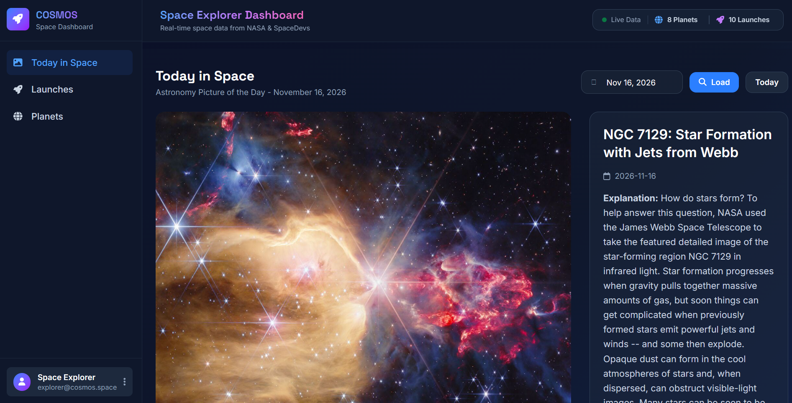

# 🚀 COSMOS | Space Explorer Dashboard

An interactive and responsive space exploration dashboard that brings the wonders of the universe closer to you. Explore our solar system, discover fascinating planetary facts, view NASA's Astronomy Picture of the Day, and stay updated on upcoming space missions.

## Screenshots 
<p align="center">
  
</p>

## 🌐 Live Demo 

[Explore COSMOS](https://evronia.github.io/Cosmos-Space/)

## ✨ Features

- **Today in Space:** Discover NASA's Astronomy Picture of the Day with detailed explanations and high-resolution images.
- **Date Explorer:** Browse astronomical pictures by selecting different dates.
- **Upcoming Launches:** Explore upcoming space missions with launch dates, times, locations, and mission details.
- **Planet Exploration:** Discover all eight planets with detailed astronomical information.
- **Planet Details:** Explore planetary characteristics, including mass, radius, gravity, orbital period, and more.
- **Planet Comparison:** Compare planets through a structured comparison table.
- **Responsive Dashboard:** Enjoy a smooth experience across desktop, tablet, and mobile devices.
- **Interactive Navigation:** Easily switch between dashboard sections.

## 🛠️ Technologies Used

- HTML5
- CSS3
- JavaScript (ES6+)
- Tailwind CSS v4
- Font Awesome 6
- Google Fonts (Space Grotesk & Inter)
- Fetch API

## 🔌 APIs & Data Sources

- **NASA APOD:** Astronomy Picture of the Day.
- **The Space Devs API:** Upcoming space launch information.
- **Solar System Open Data API:** Planetary information.

## 📁 Project Structure

```text
Cosmos-Space/
│
├── assets/
│   ├── css/
│   │   └── style.css
│   │
│   ├── images/
│   │   ├── earth.png
│   │   ├── favicon.png
│   │   ├── jupiter.png
│   │   ├── launch-placeholder.png
│   │   ├── mars.png
│   │   ├── mercury.png
│   │   ├── neptune.png
│   │   ├── placeholder.webp
│   │   ├── saturn.png
│   │   ├── uranus.png
│   │   └── venus.png
│   │
│   └── js/
│       └── index.js
│
├── index.html
└── README.md
```

## 🚀 Getting Started

To run the project locally:

1. Clone the repository:

   ```bash
   git clone https://github.com/evronia/Cosmos-Space.git
   ```

2. Navigate to the project folder:

   ```bash
   cd Cosmos-Space
   ```

3. Open `index.html` in your browser.

   Alternatively, use the Live Server extension in Visual Studio Code.

## 🎯 Project Purpose

COSMOS was developed to practice and demonstrate frontend development skills through a real-world interactive dashboard, focusing on API integration, dynamic content rendering, responsive design, and DOM manipulation.

## 👩‍💻 Developer

**Evronia Azmy**

Frontend Developer

- GitHub: [@evronia](https://github.com/evronia)

---

⭐ If you find this project interesting, feel free to give it a star!
